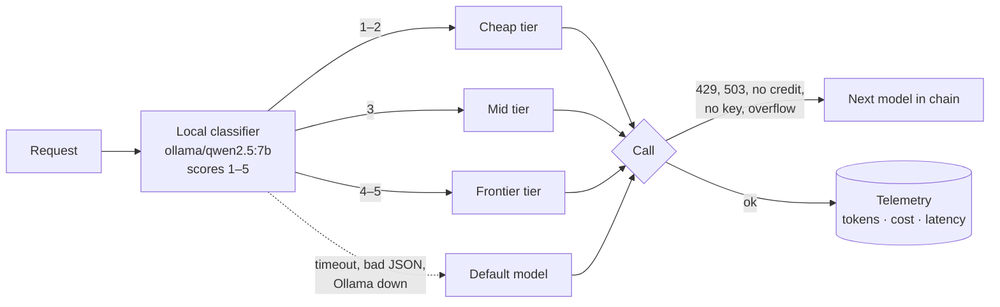

# llm-tier-router

**Send each LLM request to the cheapest model that can handle it.** A free local model scores how hard the request is, code picks the model tier, and every call is costed and logged.

Most AI spend goes on simple requests sent to frontier models: a greeting, an email to extract, a date to work out. This router keeps those on cheap models and sends only the hard ones to the frontier, then measures what that saved and what it cost in quality.

> **Results: pending.** The benchmark below has been run end to end on free local models (the pipeline works); the paid run that produces the cost figure has not been run yet. This section will hold the measured numbers, not estimates.

## How it works



- **The classifier only decides; code owns the mapping.** The local model returns a score, and `modelForComplexity` turns it into a model id. A reply like `{"complexity": "claude-opus"}` is rejected, so the classifier can never pick its own (or a paid) model.
- **A broken router never costs money.** The classifier must be a local `ollama/` model, which is checked at start-up. Timeout, bad JSON, an out-of-range score or Ollama being down all fall back to the default model.
- **Fallbacks follow the error.** Rate limits, outages, exhausted credit, a missing key and a local context overflow move down the chain. A bad request or bad auth stops at once, because it would fail the same way on every provider.
- **Local prompts are never silently cut short.** Ollama drops whatever overflows its context window and the model then invents what it lost. The router refuses an oversized local prompt and moves to the next model instead.
- **Every call is costed.** Usage from every provider is normalised (prompt, cached, completion), priced from `prices.json`, and written to SQLite with latency and the routing decision. An unpriced model is reported as unpriced, never as $0.

## Use it

```ts
import { createRouter, createTelemetry } from "llm-tier-router";
import prices from "llm-tier-router/prices.json" with { type: "json" };

const router = createRouter({
  classifierModel: "ollama/qwen2.5:7b",
  tiers: {
    cheap: "openrouter/deepseek/deepseek-v4.1-flash",
    mid: "openrouter/minimax/minimax-m2.7",
    frontier: "openrouter/anthropic/claude-sonnet-5.5",
  },
  defaultModel: "openrouter/minimax/minimax-m2.7",
  fallbacks: ["ollama/qwen2.5:7b"],
  prices: prices.prices,
  telemetry: createTelemetry("calls.db"),
});

const { completion, decision, costUsd } = await router.call([{ role: "user", content: "Extract the email from: …" }]);
// decision → { model: "openrouter/deepseek/deepseek-v4.1-flash", complexity: 1, routed: true, routerMs: 410 }
```

Keys come from `OPENROUTER_API_KEY`, `ANTHROPIC_API_KEY` and `GROQ_API_KEY`; a model whose key is missing is skipped. Requires Node 22.13+ (it uses the built-in `node:sqlite`) and [Ollama](https://ollama.com) for the classifier. No runtime dependencies.

## The benchmark

The same 115 tasks go through two arms: **frontier** (every task to the frontier model) and **routed** (the classifier picks the tier). Every answer is graded in code; no model-written code is executed.

| Kind | Tasks | Graded by |
| --- | ---: | --- |
| Extract an email address | 15 | exact match |
| Two-digit multiplication | 10 | number |
| Record → typed JSON | 15 | JSON structure |
| Date arithmetic | 15 | exact date |
| GSM8K maths word problems (public set) | 40 | number |
| 5-person ordering puzzles, unique solution | 20 | exact order |

```bash
npm install
npm run bench -- --dry-run            # task count and upper-bound cost, calls nothing
npm run bench -- --local --tasks 2    # free smoke test on local models
npm run bench -- --max-usd 3          # paid run; stops scheduling once spend passes the cap
```

The report gives success rate, cost and p50/p95 latency per arm, success by task kind, where each kind was routed, and every **misroute**: a task the frontier model passed and a cheaper model failed. Prices are in `prices.json` with their source and date.

## What broke along the way

- **Silent truncation.** In the system this was extracted from, a long prompt overflowed Ollama's 4,096-token window. Ollama dropped the overflow without an error, and the model confidently answered "port 443" for a port it had never seen. Hence the refusal above.
- **Cold starts.** Loading the classifier takes about 4.5 s, longer than the 3 s routing timeout. In the first smoke run, 4 of 12 requests fell back to the default model for that reason alone. Warming the classifier before the run took fallbacks to 0 and the average classifier time to 412 ms. In production, set `OLLAMA_KEEP_ALIVE`.

## Tests

```bash
npm test   # 30 tests: routing, fallback chain, providers, telemetry, graders, puzzle uniqueness
```

The routing tests record every outgoing request and assert the router itself only ever contacts `localhost:11434`.

## Licence

MIT. The GSM8K sample is from [openai/grade-school-math](https://github.com/openai/grade-school-math) (MIT); see `bench/tasks/ATTRIBUTION.md`.
